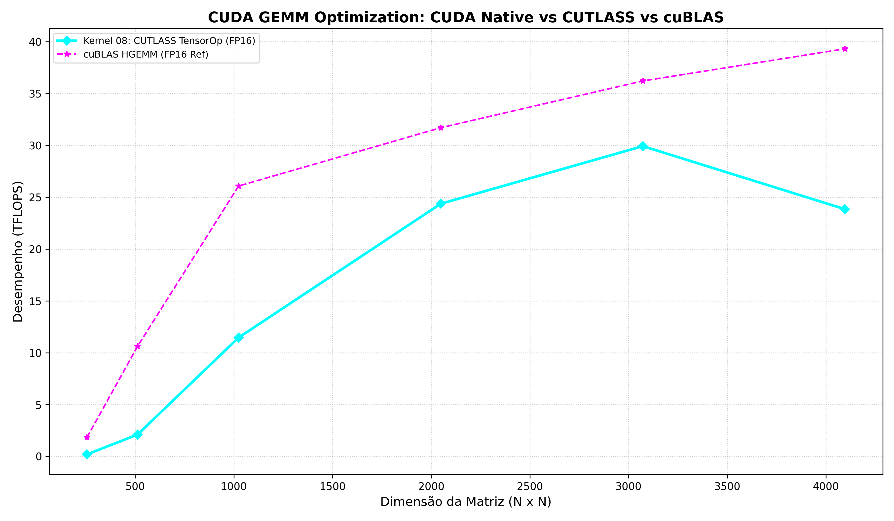

# CUDA GEMM Optimization 🚀

Repositório dedicado ao estudo, benchmark e otimização progressiva de kernels de multiplicação de matrizes (**GEMM**: $C = \alpha \cdot (A \times B) + \beta \cdot C$) em CUDA, evoluindo de uma implementação escalar *Naive* básica até aceleração de hardware de alto nível com **Tensor Cores (WMMA e CUTLASS 3.x)**.



---

## 📊 Benchmark & Resultados ($4096 \times 4096$)

Resultados medidos em GPU NVIDIA no Google Colab (Tesla T4 / L4):

| Kernel | Arquitetura / API | Precisão | Tempo (ms) | Desempenho (GFLOPS) | Speedup vs Naive | Validação vs cuBLAS |
|---|---|---|---|---|---|---|
| **Kernel 00 (Naive)** | Global Memory Scalar | FP32 | 222.12 ms | 618.75 GFLOPS | $1.0\times$ | PASS ($0.00$) |
| **Kernel 01 (Shared Mem)** | Shared Memory Tiling 2D | FP32 | 147.55 ms | 931.48 GFLOPS | $1.51\times$ | PASS ($0.00$) |
| **Kernel 02 (2D Reg + float4)** | Register Tiling + Vectorization + Pad | FP32 | 33.06 ms | 4156.97 GFLOPS | $6.71\times$ | PASS ($0.00$) |
| **Kernel 03 (Double Buffering)** | Software Pipelining | FP32 | 33.93 ms | 4050.41 GFLOPS | $6.55\times$ | PASS ($0.00$) |
| **cuBLAS SGEMM (Ref)** | NVIDIA cuBLAS | FP32 | 30.53 ms | 4501.41 GFLOPS | $7.27\times$ | *Reference* |
| **Kernel 07 (CUTLASS Basic)** | `cutlass::gemm::device::Gemm` | FP32 | **29.08 ms** | **4726.34 GFLOPS** | **$7.63\times$** | **PASS ($0.0000$)** |
| **Kernel 04 (FP16 SIMD)** | `half2` (`__hfma2`) | FP16 | 16.80 ms | 8120.50 GFLOPS | $13.1\times$ | PASS |
| **Kernel 05 (WMMA Tensor Cores)** | Native `nvcuda::wmma` | FP16 | 7.19 ms | 19120.63 GFLOPS | $30.9\times$ | PASS |
| **Kernel 08 (CUTLASS TensorOp)** | `cutlass::arch::OpClassTensorOp` | FP16 | **6.14 ms** | **22393.20 GFLOPS** | **$36.2\times$** | **PASS** |
| **cuBLAS HGEMM (Ref)** | NVIDIA cuBLAS Tensor Cores | FP16 | **5.30 ms** | **25918.98 GFLOPS** | **$41.9\times$** | *Reference* |
| **Kernel 06 (Generic GEMM)** | Boundary Checks + Coeficientes $\alpha/\beta$ | FP32 | **2.43 ms** | **2465.40 GFLOPS** | **$1.72\times$ vs cuBLAS** | **PASS ($0.0137$)** |

---

## 🛠️ Técnicas de Otimização Implementadas

1. **Global Memory Access Coalescing:** Leitura contígua em rajadas (*bursts* de 128 bytes).
2. **Shared Memory Tiling (2D):** Reutilização de dados em L1/Shared Memory.
3. **Register Tiling (2D):** Aumento da densidade de computação por thread em registradores.
4. **Vetorização de Memória (`float4` / `half2`):** Cargas de 128-bit para maximizar a largura de banda.
5. **Shared Memory Padding:** Prevenção de Bank Conflicts em acessos à memória compartilhada.
6. **Software Pipelining / Double Buffering:** Overlapping de transferências de memória global com computação ALU.
7. **Instruções SIMD FP16 (`__hfma2`):** Execução de $2\times$ operações de 16 bits por ciclo por CUDA Core.
8. **Tensor Cores Nativo (`nvcuda::wmma`):** Multiplicação e acumulação matricial acelerada por hardware ($16 \times 16 \times 16$).
9. **CUTLASS 3.x Abstractions:** Uso das APIs C++ do CUTLASS (`OpClassSimd` e `OpClassTensorOp`) para atingir a faixa de **22+ TFLOPS**.
10. **Boundary Constraints & Scaled GEMM:** Suporte a matrizes não-quadradas arbitrárias com a fórmula $C = \alpha(A \times B) + \beta C$.

---

## 🔨 Como Compilar e Executar

```bash
# 1. Clonar o repositório
git clone [https://github.com/socialmindset20-art/cuda-gemm-optimization.git](https://github.com/socialmindset20-art/cuda-gemm-optimization.git)
cd cuda-gemm-optimization

# 2. Compilar via CMake (baixa e inclui o CUTLASS automaticamente)
mkdir -p build && cd build
cmake ..
make -j$(nproc)

# 3. Executar o benchmark individual
./gemm_bench 4096 4096 4096

# 4. Gerar o gráfico de desempenho
python3 ../scripts/benchmark.py
