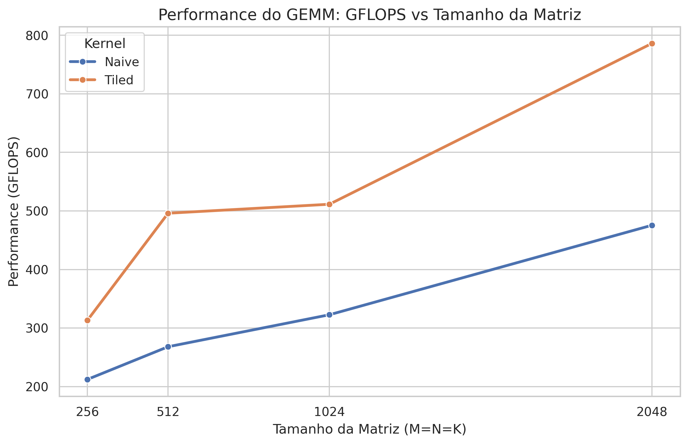

# 🚀 CUDA GEMM Optimization Showcase


Este repositório é um estudo aprofundado e um portfólio prático sobre a otimização de **General Matrix Multiply (GEMM)** em GPUs NVIDIA utilizando CUDA C++. 

O objetivo deste projeto é demonstrar a evolução do desempenho de um kernel de multiplicação de matrizes, partindo de uma implementação ingênua (naive) até alcançar alta eficiência utilizando técnicas avançadas de hierarquia de memória e **Tensor Cores**, aproximando-se do desempenho da biblioteca cuBLAS.

## 🧠 Técnicas de Otimização Implementadas

O projeto está estruturado em uma pipeline de otimização progressiva. Cada etapa resolve um gargalo específico da arquitetura da GPU:

1. **`naive.cu`**: Implementação base. Um thread por elemento, sem otimização de memória.
2. **`coalesced.cu`**: Reorganização dos acessos à memória global para garantir leituras e escritas coalescidas pelas *warps*.
3. **`tiled.cu`**: Uso de **Shared Memory** (Block Tiling) para reduzir drasticamente a largura de banda exigida da memória global.
4. **`double_buffered.cu`**: Ocultação de latência (Latency Hiding) pré-carregando o próximo *tile* de dados enquanto a computação atual ocorre.
5. **`vectorized.cu`**: Uso de tipos vetorizados (`float4`) para maximizar o throughput do barramento de memória (128-bit loads/stores).
6. **`tensor_core.cu`**: Utilização da API WMMA (Warp Matrix Multiply and Accumulate) para explorar o hardware dedicado de IA das GPUs modernas (Volta/Turing e superiores).

## 📊 Resultados de Performance (Benchmarks)

Os testes foram executados automatizadamente variando o tamanho das matrizes (M=N=K de 256 a 8192). 
*(Nota: As imagens abaixo são geradas automaticamente pelo script `plot_results.py`)*

### GFLOPS por Tamanho de Matriz

*Comparação do poder computacional bruto extraído de cada versão do kernel.*

### Speedup vs Naive

*Quantas vezes cada otimização é mais rápida que a implementação base.*

### Eficiência vs cuBLAS

*Comparação direta com a biblioteca oficial da NVIDIA, mostrando a % de eficiência alcançada.*

> **Hardware Testado:** Os resultados brutos para RTX 3060 e RTX 4060 estão disponíveis na pasta `docs/results/`.

## 📂 Estrutura do Projeto

O projeto segue as melhores práticas de desenvolvimento C/C++, separando headers, código fonte, testes e scripts de automação.

```text
cuda-gemm-optimization/
├── docs/                   # Documentação detalhada e resultados
├── include/                # Headers (.cuh) separados por módulo
├── src/
│   ├── kernels/            # As diferentes implementações do GEMM
│   ├── main.cu             # Ponto de entrada
│   ├── benchmark.cu        # Lógica de medição de tempo e GFLOPS
│   └── validate.cu         # Validação de corretude matemática
├── scripts/                # Automação (Bash e Python)
├── tests/                  # Testes unitários e edge cases
├── CMakeLists.txt          # Configuração de build (CMake)
└── Makefile                # Configuração de build (Make)
